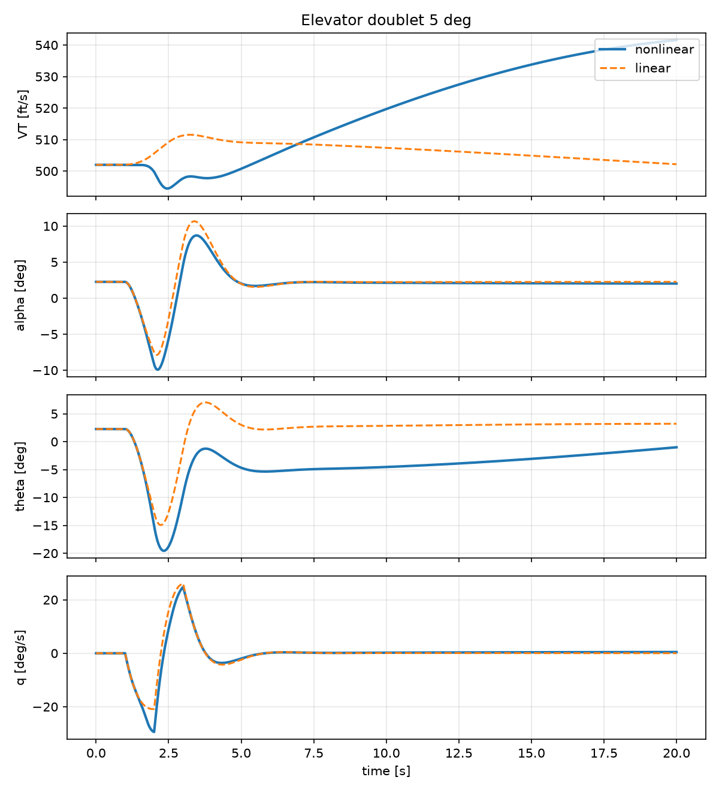
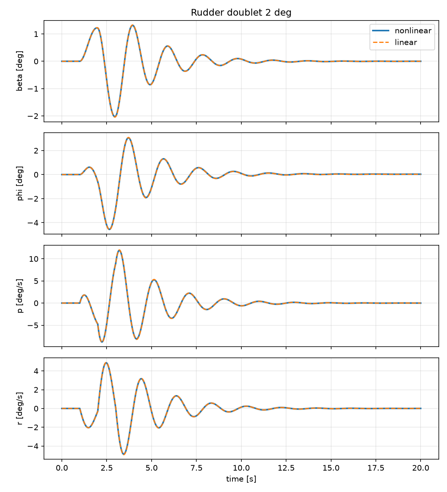
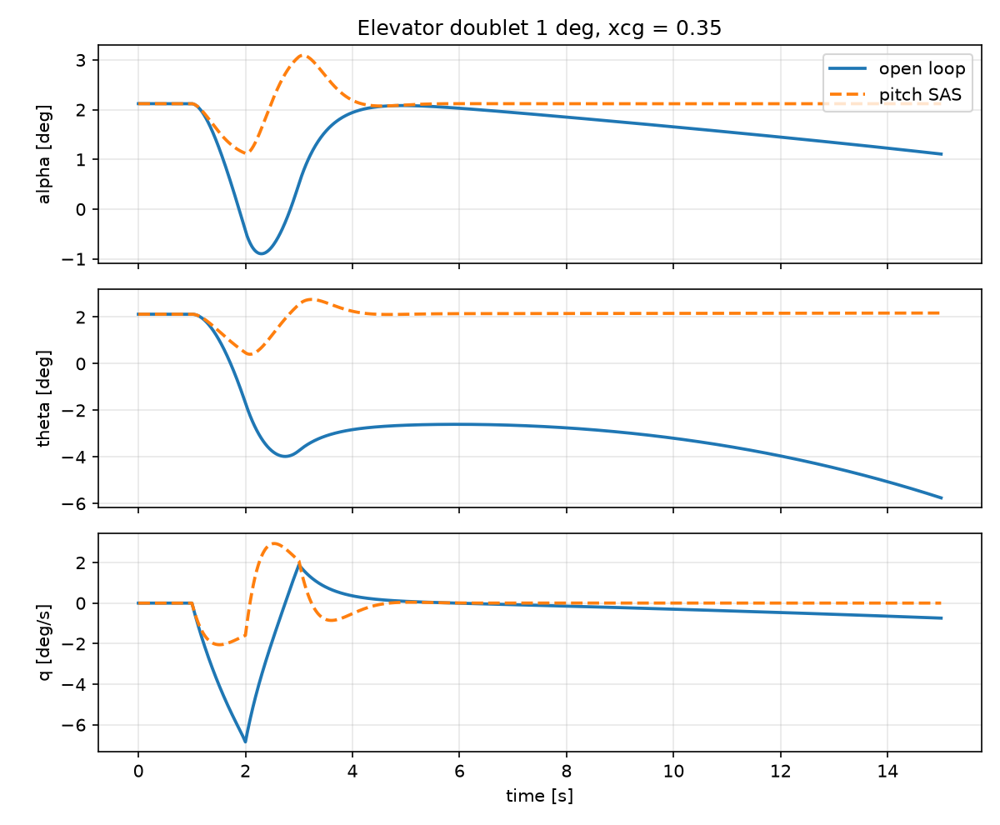
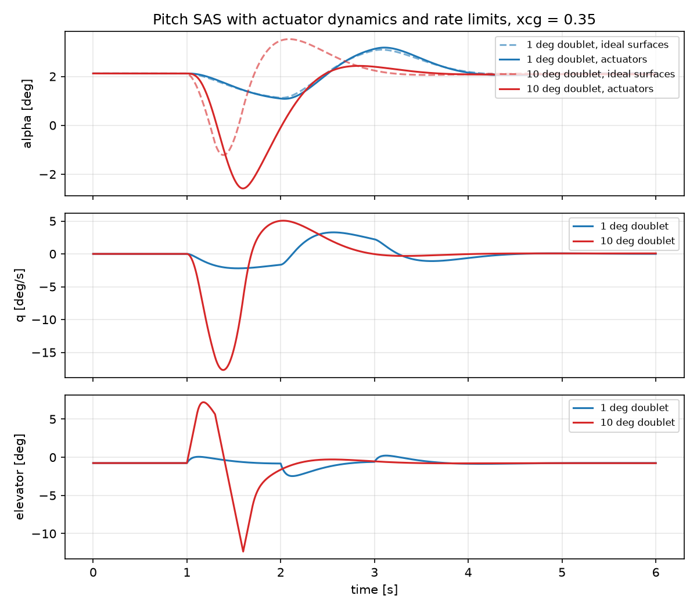
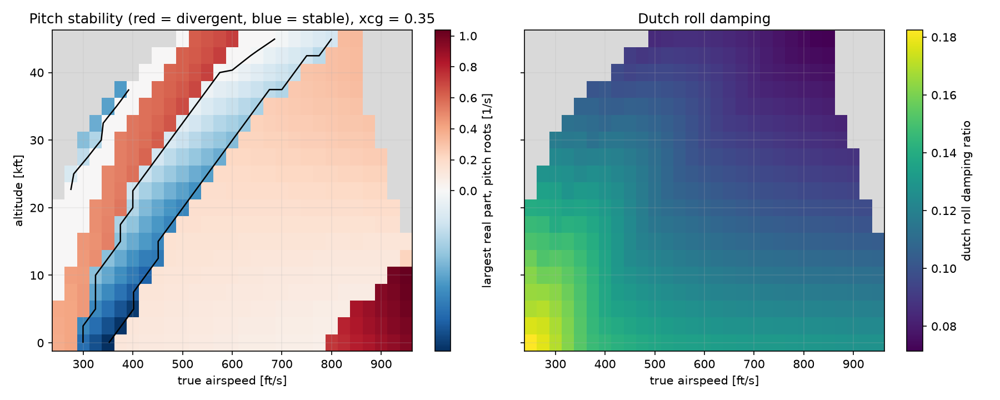
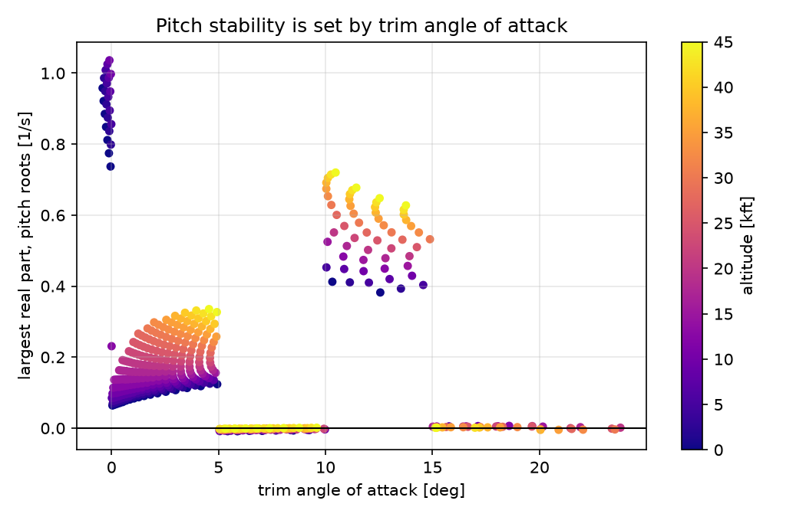

# F-16 Flight Dynamics: Nonlinear 6-DoF Model, Trim, Linearization and Validation


A nonlinear six-degree-of-freedom F-16 flight dynamics model in Python, built from
NASA wind-tunnel data and validated step by step against the reference model of
Stevens & Lewis, *Aircraft Control and Simulation*. The project covers the full
chain from aerodynamic tables to trim, linearization, modal analysis, time-domain
simulation and a flight control system for the statically unstable airframe.

## Highlights

- **Validated model:** trim, eigenvalues and Jacobians match the reference
  implementation; 56 automated tests check both numbers and physics.
- **Relaxed static stability reproduced:** at the nominal CG the airframe has an
  unstable pitch root, exactly why the real F-16 needs fly-by-wire.
- **Linear model validity quantified:** linear vs nonlinear error is 0.5 % for a
  1 deg elevator doublet and 26 % for 5 deg, where alpha reaches the table edge.
- **Cross-validated modes:** the dutch roll period measured from nonlinear
  simulation agrees with the eigenvalue prediction within 3 %.
- **Flight control system:** pitch SAS and yaw damper designed by pole placement,
  with actuator rate limits and washout; 63.8 deg phase margin and 374 ms delay
  margin in pitch, robust across CG 0.30–0.38 and 350–700 ft/s.

## Validation results

### Trim (sea level, VT = 502 ft/s, xcg = 0.35)

| Quantity | This model | Reference |
|---|---|---|
| Throttle | 0.13855 | 0.1385 |
| Elevator | -0.7582 deg | -0.7588 deg |
| Angle of attack | 2.1215 deg | 2.1148 deg |

The solver drives the remaining accelerations to ~1e-15. Applying the reference
values to the model leaves a small residual (alpha_dot ~ 1e-4 rad/s), which
accounts for the difference in angle of attack.

### Open-loop modes (sea level, VT = 502 ft/s)

| Mode | xcg = 0.30 | xcg = 0.35 | xcg = 0.38 |
|---|---|---|---|
| Short period | wn = 1.91 rad/s, zeta = 0.63 | **unstable real root, +0.098** | **unstable real root, +0.656** |
| Phugoid | period 85 s, zeta = 0.12 | coupled with pitch roots | period 54 s, zeta = 0.14 |
| Dutch roll | wn = 3.25 rad/s, zeta = 0.135 | wn = 3.09 rad/s, zeta = 0.137 | wn = 3.00 rad/s, zeta = 0.138 |
| Roll | tau = 0.28 s | tau = 0.28 s | tau = 0.28 s |
| Spiral | tau = 78 s (stable) | tau = 70 s (stable) | tau = 65 s (stable) |

Moving the CG aft destroys the classic short-period oscillation and produces a
divergent pitch mode; at xcg = 0.38 the divergence doubles in about one second.

### Linear vs nonlinear response (xcg = 0.30)

| Input | Peak response | Max linear error |
|---|---|---|
| Elevator doublet 1 deg | alpha 2.04 deg | 0.5 % |
| Elevator doublet 5 deg | alpha 12.2 deg | 25.8 % |
| Rudder doublet 2 deg | beta 2.02 deg | 1.3 % |





### Stability augmentation (xcg = 0.35)

Angle-of-attack and pitch-rate feedback to the elevator, yaw-rate feedback to
the rudder. Gains are found by pole placement for a short period of
wn = 3 rad/s, zeta = 0.7 and dutch roll damping of 0.5.

| Mode | Open loop | With SAS |
|---|---|---|
| Pitch | unstable root +0.098 | short period wn = 3.0, zeta = 0.70 |
| Phugoid | coupled | period 83 s, zeta = 0.12 |
| Dutch roll | zeta = 0.137 | zeta = 0.50 |



### Flight control system with actuators (xcg = 0.35)

First-order surface actuators (20.2 rad/s) with position and rate limits,
and a 1 s washout on the yaw-damper feedback.

| Loop | Phase margin | Delay margin | Gain margin |
|---|---|---|---|
| Pitch (alpha + q) | 63.8 deg at 2.98 rad/s | 374 ms | gain may drop 18.8 dB before instability |
| Yaw damper | 109.5 deg at 4.29 rad/s | 445 ms | open loop stable |

With the washout, dutch roll damping is 0.59 while the spiral mode stays free
(time constant ~70 s), so the damper does not oppose steady turns. Large inputs
saturate the 60 deg/s elevator rate limit, which delays the SAS response and
roughly doubles the angle-of-attack excursion compared with ideal surfaces.


### Flight envelope survey (xcg = 0.35)

Trim and linearization over 551 grid points (250–950 ft/s, 0–45,000 ft).
A point is inside the envelope when trim exists below full throttle, with
alpha below the 25 deg limiter and Mach below 0.9: 474 points qualify.



Pitch stability depends on trim angle of attack rather than on speed or
altitude: every grid point falls into bands set by the local slope of
Cm(alpha). The airframe is divergent for alpha below 5 deg and between 10 and
15 deg, with the fastest divergence (time to double 0.67 s) at high speed and
low altitude. The sharp jumps at 5 deg boundaries are an artifact of linear
table interpolation, whose derivatives are piecewise constant; a smooth
aerodynamic representation would give continuous transitions.



Dutch roll damping stays between 0.07 and 0.18 across the envelope and falls
with altitude, so a yaw damper is needed everywhere.

## Physics found in the data

Several tests check physical behavior rather than numbers:

- Dihedral effect (Cl_beta < 0) and weathercock stability (Cn_beta > 0) at cruise.
- Loss of directional stability at high angle of attack (Cn_beta < 0 at 40 deg),
  one reason the F-16 flight control system limits angle of attack.
- Back side of the power curve: trimmed flight at 300 ft/s needs more throttle
  than at 400 ft/s.
- Engine gyroscopic coupling: in symmetric flight the only link between the
  longitudinal and lateral dynamics is the engine rotor angular momentum.

## Model

- Flat, non-rotating Earth; rigid aircraft with constant mass.
- Aerodynamics: NASA TP-1538 tables (alpha -10 to 45 deg) with linear
  extrapolation beyond the table edges, matching the reference.
- F100 engine with throttle gearing, first-order power lag and afterburner logic.
- Simplified standard atmosphere, isothermal above 35,000 ft.
- English units internally (ft, slug, lbf), so results compare directly with the reference.

State vector: `[VT, alpha, beta, phi, theta, psi, p, q, r, north, east, alt, power]`.
Controls: `[throttle, elevator, aileron, rudder]`.

## Project structure

```
f16/
  constants.py     geometry, mass and inertia
  atmosphere.py    atmosphere and air data computer
  aero_tables.py   aerodynamic coefficient tables and interpolation
  engine.py        F100 engine model
  dynamics.py      nonlinear 6-DoF equations of motion
  trim.py          trim solver for steady wings-level flight
  linearize.py     numerical Jacobians and modal analysis
  simulate.py      open- and closed-loop time simulation
  sas.py           pitch SAS and yaw damper design
  fcs.py           actuators, washout and stability margins
tests/             56 tests: reference values and physical checks
modal_report.py        trim and modes at several CG positions
compare_responses.py   linear vs nonlinear doublet responses
sas_demo.py            open-loop vs SAS responses
fcs_demo.py            stability margins and actuator effects
```

## Quick start

```bash
python -m venv .venv
.venv\Scripts\activate          # Windows
source .venv/bin/activate       # macOS / Linux
pip install numpy scipy matplotlib pytest

pytest -v
python modal_report.py
python compare_responses.py
python sas_demo.py
python fcs_demo.py
```

## Limitations

- Euler angles are singular at theta = +/-90 deg; quaternions would be needed for vertical maneuvers.
- Sensor dynamics and computational delay are not modeled; the delay margin
  shows how much latency the loops can tolerate.
- SAS gains are designed at a single flight condition; no gain scheduling.
- Aerodynamic data ends at alpha = 45 deg; post-stall behavior is extrapolated.

## References

1. B. L. Stevens, F. L. Lewis, *Aircraft Control and Simulation*, 2nd ed., Wiley, 2003.
2. L. T. Nguyen et al., *Simulator Study of Stall/Post-Stall Characteristics of a Fighter
   Airplane with Relaxed Longitudinal Static Stability*, NASA TP-1538, 1979.
3. P. Heidlauf, A. Collins, M. Bolender, S. Bak, *Verification Challenges in F-16 Ground
   Collision Avoidance and Other Automated Maneuvers*, ARCH 2018
   ([AeroBenchVVPython](https://github.com/stanleybak/AeroBenchVVPython)).
4. MIL-F-8785C, *Flying Qualities of Piloted Airplanes*, 1980.

## License

GPL-3.0. The aerodynamic and engine table values follow AeroBenchVVPython (GPL-3.0).