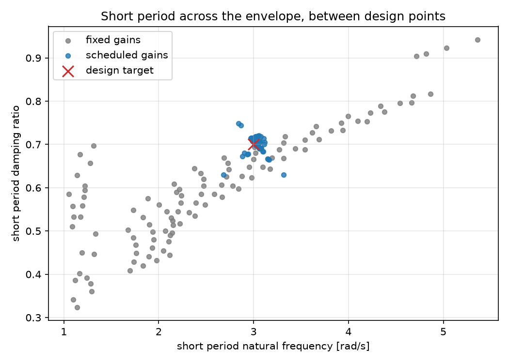
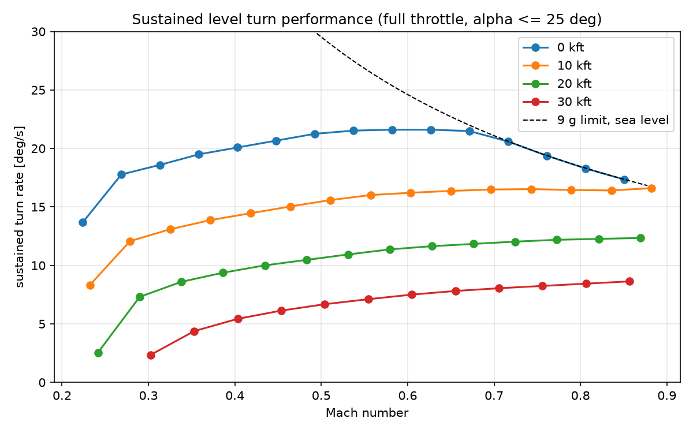
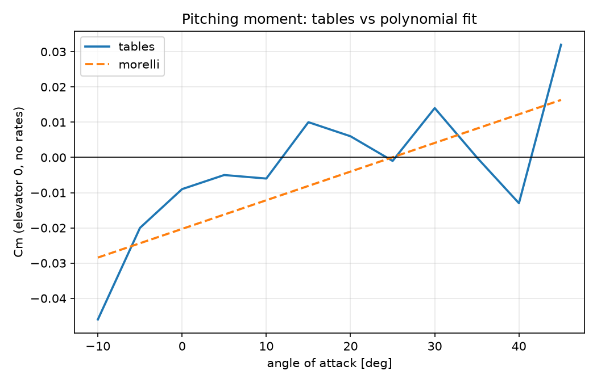
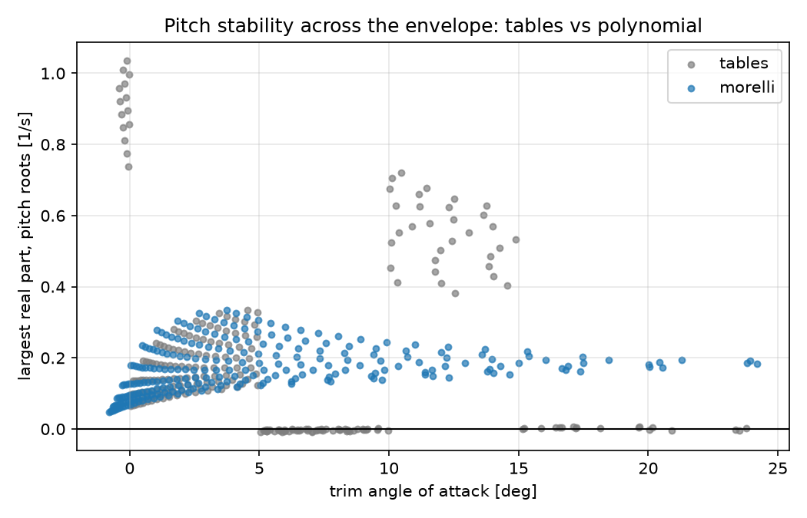
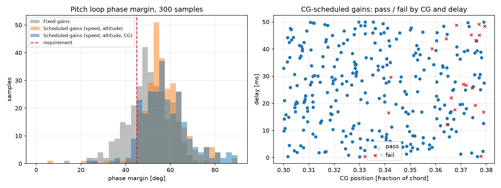
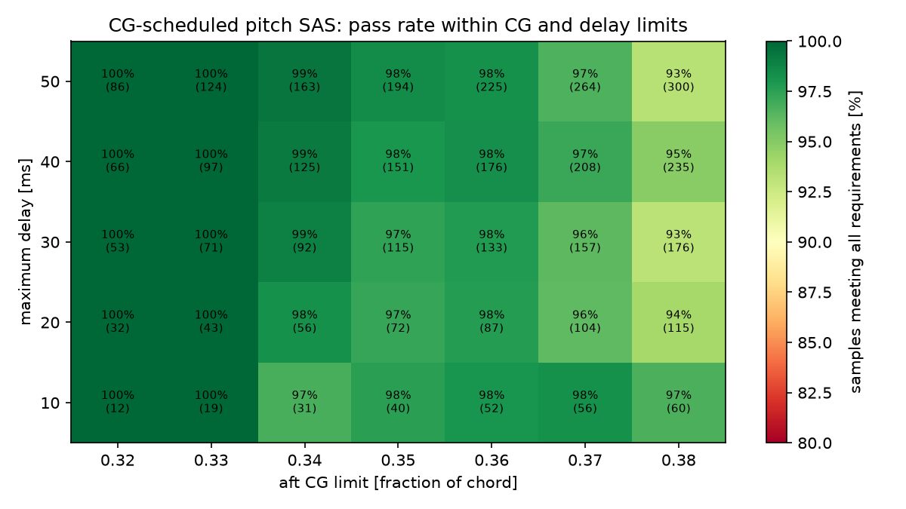
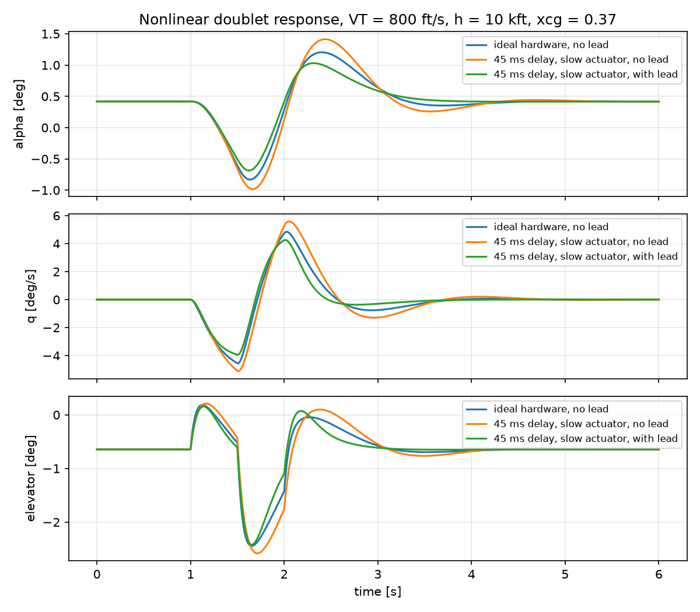

# F-16 Flight Dynamics and Flight Control: From Wind-Tunnel Data to a Robust SAS


A nonlinear six-degree-of-freedom F-16 model in Python, built from NASA wind-tunnel
data and validated against Stevens & Lewis, *Aircraft Control and Simulation*, followed
by the design and robustness assessment of a stability augmentation system (SAS) for
the statically unstable airframe. 105 automated tests check both reference values and
physical behavior.

## Highlights

- **Validated model:** trim, Jacobians and eigenvalues match the reference implementation;
  linear and nonlinear responses agree within 0.5 % for small inputs.
- **Relaxed static stability reproduced:** at the nominal CG the airframe diverges in pitch,
  which is why the real F-16 needs fly-by-wire.
- **Full-envelope analysis:** trim and stability over 474 flight conditions, coordinated
  turns, pull-ups and sustained turn performance.
- **Model-form uncertainty:** a second, polynomial aerodynamic model (Morelli, 1998) shows
  that some stability features of the lookup tables are interpolation artifacts.
- **Robust flight control:** gain-scheduled SAS with actuators, washout and a lead filter,
  tested by Monte Carlo over flight condition, CG, aerodynamic, actuator and delay
  uncertainty. The pass rate rose from **71 % to 98–99 %**, confirmed on unseen samples
  and on both aerodynamic models, and the analysis produced a **40 ms delay budget**
  for the flight control hardware.

## Contents

1. [Model validation](#1-model-validation)
2. [Stability augmentation](#2-stability-augmentation)
3. [Flight envelope](#3-flight-envelope)
4. [Maneuvers and turn performance](#4-maneuvers-and-turn-performance)
5. [Two aerodynamic models](#5-two-aerodynamic-models)
6. [Monte Carlo robustness and controller design](#6-monte-carlo-robustness-and-controller-design)
7. [Model, structure and usage](#7-model-structure-and-usage)

---

## 1. Model validation

### Trim (sea level, VT = 502 ft/s, xcg = 0.35)

| Quantity | This model | Reference |
|---|---|---|
| Throttle | 0.13855 | 0.1385 |
| Elevator | -0.7582 deg | -0.7588 deg |
| Angle of attack | 2.1215 deg | 2.1148 deg |

The solver drives the remaining accelerations to ~1e-15. Applying the reference
values leaves a small residual (alpha_dot ~ 1e-4 rad/s), which accounts for the
difference in angle of attack.

### Open-loop modes (sea level, VT = 502 ft/s)

| Mode | xcg = 0.30 | xcg = 0.35 | xcg = 0.38 |
|---|---|---|---|
| Short period | wn = 1.91 rad/s, zeta = 0.63 | **unstable real root, +0.098** | **unstable real root, +0.656** |
| Phugoid | period 85 s, zeta = 0.12 | coupled with pitch roots | period 54 s, zeta = 0.14 |
| Dutch roll | wn = 3.25 rad/s, zeta = 0.135 | wn = 3.09 rad/s, zeta = 0.137 | wn = 3.00 rad/s, zeta = 0.138 |
| Roll | tau = 0.28 s | tau = 0.28 s | tau = 0.28 s |
| Spiral | tau = 78 s | tau = 70 s | tau = 65 s |

Moving the CG aft destroys the short-period oscillation and produces a divergent
pitch mode; at xcg = 0.38 the divergence doubles in about one second.

### Linear vs nonlinear response (xcg = 0.30)

| Input | Peak response | Max linear error |
|---|---|---|
| Elevator doublet 1 deg | alpha 2.04 deg | 0.5 % |
| Elevator doublet 5 deg | alpha 12.2 deg | 25.8 % |
| Rudder doublet 2 deg | beta 2.02 deg | 1.3 % |

The dutch roll period measured in nonlinear simulation agrees with the eigenvalue
prediction within 3 %. At 5 deg, alpha reaches the edge of the aerodynamic tables
and the linear model is no longer adequate.


### Physics checked by the tests

- Dihedral effect (Cl_beta < 0) and weathercock stability (Cn_beta > 0) at cruise.
- Loss of directional stability at high angle of attack (Cn_beta < 0 at 40 deg).
- Back side of the power curve: level flight at 300 ft/s needs more throttle than at 400 ft/s.
- Engine gyroscopic coupling: in symmetric flight the only link between longitudinal and
  lateral dynamics is the engine rotor angular momentum.

---

## 2. Stability augmentation

Angle-of-attack and pitch-rate feedback to the elevator stabilize the airframe;
yaw-rate feedback to the rudder through a 1 s washout damps the dutch roll without
opposing steady turns. Gains come from pole placement.

| Mode (xcg = 0.35) | Open loop | With SAS |
|---|---|---|
| Pitch | unstable root +0.098 | short period wn = 3.0, zeta = 0.70 |
| Dutch roll | zeta = 0.137 | zeta = 0.50 (0.59 with washout and actuators) |

With first-order actuators (20.2 rad/s) and rate limits:

| Loop | Phase margin | Delay margin | Gain margin |
|---|---|---|---|
| Pitch | 63.8 deg at 2.98 rad/s | 374 ms | gain may drop 18.8 dB before instability |
| Yaw damper | 109.5 deg at 4.29 rad/s | 445 ms | open loop stable |

Because the airframe is unstable, the critical gain margin is a gain *reduction*:
if the SAS gain falls too far, for example after a sensor fault, the aircraft diverges.
Large inputs saturate the 60 deg/s elevator rate limit and roughly double the
angle-of-attack excursion compared with ideal surfaces.


---

## 3. Flight envelope

Trim and linearization over 551 grid points (250–950 ft/s, 0–45,000 ft). A point is
inside the envelope when trim exists below full throttle, with alpha below the 25 deg
limiter and Mach below 0.9: 474 points qualify.


Pitch stability depends on trim angle of attack rather than on speed or altitude:
every point falls into bands set by the local slope of Cm(alpha). The fastest
divergence (time to double 0.67 s) is at high speed and low altitude. Dutch roll
damping stays between 0.07 and 0.18 everywhere and falls with altitude.


### Gain scheduling

SAS gains are designed at every grid point and interpolated in speed, altitude and CG.
Between the design points, over 111 off-grid conditions:

| | Short-period wn | Short-period zeta |
|---|---|---|
| Fixed gains (one design point) | 1.05 – 5.36 rad/s | 0.32 – 0.94 |
| Scheduled gains | 2.68 – 3.31 rad/s | 0.63 – 0.75 |
| Target | 3.0 | 0.7 |



---

## 4. Maneuvers and turn performance

Trim is extended to coordinated level turns (8 unknowns: controls, alpha, beta,
bank and pitch attitude) and symmetric pull-ups.

| Turn rate (502 ft/s, sea level) | Bank | Alpha | Load factor | Throttle |
|---|---|---|---|---|
| 5 deg/s | 53.8 deg | 4.24 deg | 1.69 | 0.205 |
| 10 deg/s | 70.0 deg | 8.09 deg | 2.90 | 0.411 |
| 15 deg/s | 76.5 deg | 12.04 deg | 4.21 | 0.756 |
| 20 deg/s | 80.0 deg | 15.93 deg | 5.54 | 0.959 |

- Pull-up load factor matches n = 1 + V q / g to four significant digits; level-turn load
  factor matches sqrt(1 + (V w / g)^2) within 0.1 %.
- Coordinated turns need a small rudder input to cancel adverse yaw.
- In pull-ups, more load factor needs *less* nose-up elevator between 10 and 15 deg/s:
  the trim alpha enters the strongly unstable band, a stick-force reversal a pilot could
  not handle without fly-by-wire.



Sustained turn rate peaks at 21.6 deg/s (Mach 0.58, sea level). At low speed it is
thrust limited, at high speed it meets the 9 g structural limit; the transition is the
corner speed. At 30,000 ft the best sustained rate falls to 8.6 deg/s.

---

## 5. Two aerodynamic models

The lookup tables interpolate linearly between 5 deg breakpoints, so their derivatives,
and therefore linearized stability, jump at every breakpoint. A second model, the
global polynomial fit of Morelli (1998) to the same NASA data, is smooth.



| | Tables | Polynomial |
|---|---|---|
| Nominal trim alpha | 2.12 deg | 1.45 deg |
| Nominal unstable pitch root | +0.098 | +0.094 |
| Largest pitch root over the envelope | 1.04 1/s | 0.34 1/s |
| Largest jump in pitch root, 10 ft/s speed steps | 0.13 | 0.003 |

The two models agree at the nominal point but disagree strongly elsewhere: the tables
show neutrally stable bands that the polynomial does not. This model-form uncertainty
matters for control design, so the SAS designed on the tables was also verified on the
polynomial model, where it stays stable at all 111 off-grid points tested.



AeroBenchVVPython adds the table damping derivatives on top of the polynomial model,
whose polynomials already contain damping terms; this implementation follows
Morelli (1998).

---

## 6. Monte Carlo robustness and controller design

Each sample draws a flight condition inside the envelope and a set of uncertainties;
the pitch loop is rebuilt and checked against four requirements: closed-loop
stability, phase margin of at least 45 deg, at least 6 dB of gain reduction before
instability, and short-period damping between 0.35 and 1.30 (MIL-F-8785C, Level 1).

| Uncertainty | Distribution |
|---|---|
| Flight condition | uniform inside the envelope |
| CG position | uniform, 0.30 – 0.38 (re-trimmed on the nonlinear model) |
| Pitch damping Mq | normal, mean 1, sigma 15 % |
| Elevator effectiveness | normal, mean 1, sigma 10 % |
| Pitch inertia | uniform, ±10 % |
| Actuator bandwidth | uniform, 15 – 25 rad/s |
| Computing delay | uniform, 0 – 50 ms (Pade approximation) |

### Design iterations (300 samples, same seed)

| Design | Pass rate |
|---|---|
| Fixed gains | 71.0 % |
| Scheduled in speed and altitude | 90.7 % |
| Slower short-period target (wn = 2.5) | 93.7 % |
| Margin-optimal target with handling-qualities limit, scheduled in CG | 94.0 % |
| + lead filter (6 rad/s, ratio 2.5) | **98.3 %** |

What the iterations showed:

- **Two families of failures.** Gain-margin failures at high speed and low altitude sit
  where the two aerodynamic models disagree most, and disappear on the polynomial model:
  they are a table artifact. Phase-margin failures at aft CG appear on both models: they
  are real.
- **The crossover frequency is squeezed from both sides.** Slowing the controller helps
  against delay but brings the crossover close to the unstable pole; speeding it up does
  the opposite. Optimizing for margins alone drove the target to the slowest candidate,
  so a lower limit on the short-period frequency was added for handling qualities.
- **Gain tuning hit a ceiling.** Five gain strategies left the same aft-CG samples at
  42–45 deg of phase margin. A lead filter, an architecture change, removed all
  phase-margin failures and fixed 12 of the 14.



### Independent validation (300 unseen samples)

| Aircraft model | Without lead | With lead |
|---|---|---|
| Tables | 93.3 % | **98.3 %** |
| Polynomial | 94.7 % | **99.3 %** |

The only failures common to both models combine aft CG (0.374–0.375), maximum dynamic
pressure and more than 40 ms of delay, which gives the hardware requirement:
**total computing and sensor delay of 40 ms or less.**



An earlier limit derived from one set of samples (aft CG at 0.33) was broken by an
independent run, a reminder that limits must be validated on data they were not
derived from.

### Nonlinear check

At a worst-case corner (800 ft/s, 10,000 ft, xcg = 0.37, 45 ms delay, 15 rad/s
actuator), the lead filter was added to the nonlinear simulation:

| Case | Linear phase margin | Residual pitch rate after 3 s |
|---|---|---|
| Ideal hardware, no lead | 49.3 deg | 0.74 deg/s |
| Worst-case hardware, no lead | 39.3 deg | 1.28 deg/s |
| Worst-case hardware, with lead | 59.4 deg | 0.29 deg/s |

The nonlinear responses rank exactly as the linear margins predict, which supports
using linearized loops in the Monte Carlo.



---

## 7. Model, structure and usage

### Model

- Flat, non-rotating Earth; rigid aircraft with constant mass.
- Aerodynamics: NASA TP-1538 lookup tables (alpha -10 to 45 deg) with linear
  extrapolation, or the Morelli (1998) polynomial model.
- F100 engine with throttle gearing, first-order power lag and afterburner logic.
- Simplified standard atmosphere, isothermal above 35,000 ft.
- English units internally (ft, slug, lbf), so results compare directly with the reference.

### Limitations

- Euler angles are singular at theta = +/-90 deg; vertical maneuvers would need quaternions.
- Sensor noise is not modeled. The lead filter multiplies high-frequency gain by 2.5,
  so noise and actuator activity would grow by the same factor.
- The Monte Carlo covers the pitch loop only and uses linearized loops; the delay is a
  first-order Pade approximation.
- Gains are interpolated from tables; transients from fast changes in flight condition
  are not assessed.
- Aerodynamic data ends at alpha = 45 deg and Mach 0.9.

### Structure

```
f16/
  constants.py       geometry, mass and inertia
  atmosphere.py      atmosphere and air data computer
  aero_tables.py     NASA lookup tables and interpolation
  aero_morelli.py    polynomial aerodynamic model
  engine.py          F100 engine model
  dynamics.py        nonlinear 6-DoF equations of motion
  trim.py            level and climbing flight trim
  maneuver_trim.py   coordinated turn, pull-up, sustained turn rate
  linearize.py       numerical Jacobians and modal analysis
  simulate.py        open- and closed-loop time simulation
  sas.py             pitch SAS and yaw damper design
  fcs.py             actuators, washout, lead filter, delay, stability margins
  envelope.py        flight envelope survey
  schedule.py        gain scheduling in speed, altitude and CG
  monte_carlo.py     Monte Carlo robustness analysis
tests/               105 tests: reference values and physical checks
```

Analysis scripts (top level): `modal_report.py`, `compare_responses.py`, `sas_demo.py`,
`fcs_demo.py`, `envelope_map.py`, `schedule_demo.py`, `turn_performance.py`,
`compare_aero_models.py`, `monte_carlo_demo.py`, `requirements_study.py`,
`diagnose_failures.py`, `confidence_run.py`, `model_uncertainty_mc.py`,
`lead_study.py`, `final_validation.py`, `nonlinear_lead_demo.py`.

### Quick start

```bash
python -m venv .venv
.venv\Scripts\activate          # Windows
source .venv/bin/activate       # macOS / Linux
pip install numpy scipy matplotlib pytest

pytest -v
python modal_report.py          # seconds
python envelope_map.py          # about 10 s
python monte_carlo_demo.py      # a few minutes
```

## References

1. B. L. Stevens, F. L. Lewis, *Aircraft Control and Simulation*, 2nd ed., Wiley, 2003.
2. L. T. Nguyen et al., *Simulator Study of Stall/Post-Stall Characteristics of a Fighter
   Airplane with Relaxed Longitudinal Static Stability*, NASA TP-1538, 1979.
3. E. A. Morelli, *Global Nonlinear Parametric Modeling with Application to F-16
   Aerodynamics*, American Control Conference, 1998.
4. P. Heidlauf, A. Collins, M. Bolender, S. Bak, *Verification Challenges in F-16 Ground
   Collision Avoidance and Other Automated Maneuvers*, ARCH 2018
   ([AeroBenchVVPython](https://github.com/stanleybak/AeroBenchVVPython)).
5. MIL-F-8785C, *Flying Qualities of Piloted Airplanes*, 1980.

## License

GPL-3.0. The aerodynamic, engine and polynomial model coefficients follow
AeroBenchVVPython (GPL-3.0).