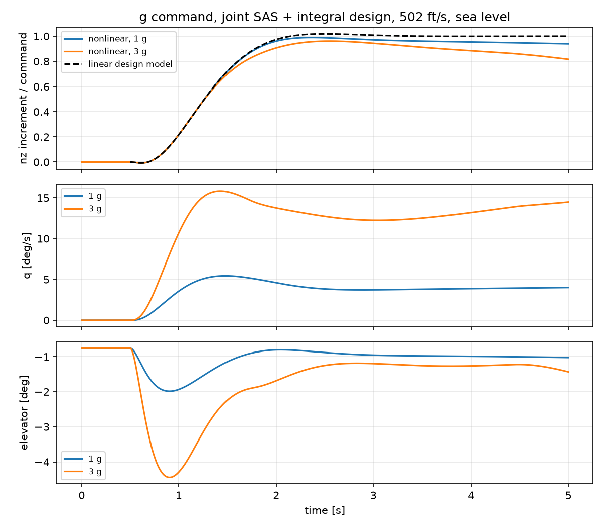
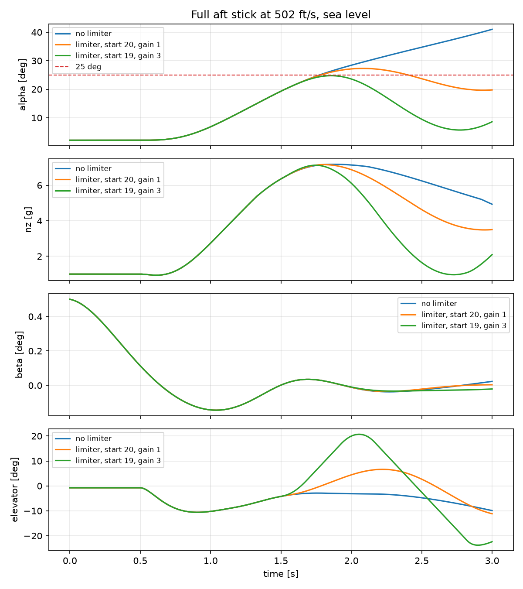
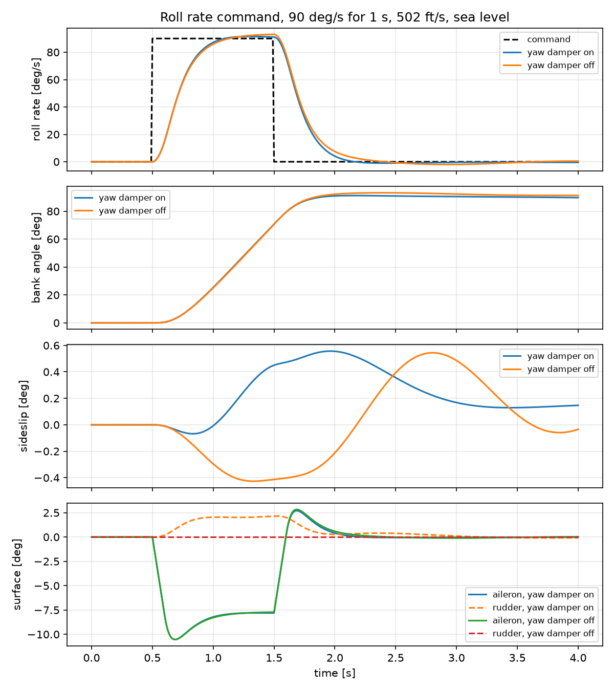
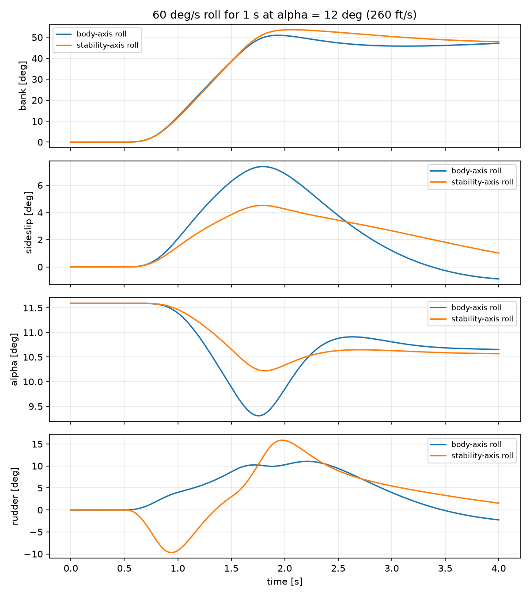

# F-16 Flight Dynamics and Flight Control: From Wind-Tunnel Data to Fly-by-Wire


A nonlinear six-degree-of-freedom F-16 model in Python, built from NASA wind-tunnel
data and validated against Stevens & Lewis, *Aircraft Control and Simulation*,
followed by the design of a fly-by-wire flight control system for the statically
unstable airframe: stability augmentation, robustness assessment by Monte Carlo,
a g command system with envelope protection, and roll rate command with
stability-axis rolling. 140 automated tests check reference values and physical
behavior.

## At a glance

| Area | Result |
|---|---|
| Model validation | Trim, Jacobians and eigenvalues match the reference; linear and nonlinear responses agree within 0.5 % for small inputs |
| Airframe | Statically unstable at the nominal CG (relaxed static stability), as on the real F-16 |
| Flight envelope | Trim and stability over 474 flight conditions; coordinated turns, pull-ups and sustained turn performance |
| Model-form uncertainty | A second, polynomial aerodynamic model shows some table-based stability features are interpolation artifacts |
| Robust SAS | Monte Carlo pass rate raised from 71 % to 98–99 %, confirmed on unseen samples and both aerodynamic models; 40 ms delay budget derived |
| g command | Joint design of the inner and outer loops after showing proportional g feedback cannot add damping on this airframe |
| Envelope protection | Full aft stick: angle of attack held at 24.8 deg instead of running to 41 deg, with 84 ft/s more speed retained |
| Roll axis | Roll rate command and stability-axis roll; sideslip in a high-alpha roll cut from 7.4 to 4.2 deg |

## Contents

1. [Model validation](#1-model-validation)
2. [Stability augmentation](#2-stability-augmentation)
3. [Flight envelope](#3-flight-envelope)
4. [Maneuvers and turn performance](#4-maneuvers-and-turn-performance)
5. [Two aerodynamic models](#5-two-aerodynamic-models)
6. [Monte Carlo robustness and controller design](#6-monte-carlo-robustness-and-controller-design)
7. [Fly-by-wire pitch axis: g command and envelope protection](#7-fly-by-wire-pitch-axis-g-command-and-envelope-protection)
8. [Fly-by-wire roll axis](#8-fly-by-wire-roll-axis)
9. [Engineering lessons](#9-engineering-lessons)
10. [Model, structure and usage](#10-model-structure-and-usage)

---

## 1. Model validation

### Trim (sea level, VT = 502 ft/s, xcg = 0.35)

| Quantity | This model | Reference |
|---|---|---|
| Throttle | 0.13855 | 0.1385 |
| Elevator | -0.7582 deg | -0.7588 deg |
| Angle of attack | 2.1215 deg | 2.1148 deg |

The solver drives the remaining accelerations to ~1e-15. Applying the reference
values leaves a small residual (alpha_dot ~ 1e-4 rad/s), which accounts for the
difference in angle of attack.

### Open-loop modes (sea level, VT = 502 ft/s)

| Mode | xcg = 0.30 | xcg = 0.35 | xcg = 0.38 |
|---|---|---|---|
| Short period | wn = 1.91 rad/s, zeta = 0.63 | **unstable real root, +0.098** | **unstable real root, +0.656** |
| Phugoid | period 85 s, zeta = 0.12 | coupled with pitch roots | period 54 s, zeta = 0.14 |
| Dutch roll | wn = 3.25 rad/s, zeta = 0.135 | wn = 3.09 rad/s, zeta = 0.137 | wn = 3.00 rad/s, zeta = 0.138 |
| Roll | tau = 0.28 s | tau = 0.28 s | tau = 0.28 s |
| Spiral | tau = 78 s | tau = 70 s | tau = 65 s |

Moving the CG aft destroys the short-period oscillation and produces a divergent
pitch mode; at xcg = 0.38 the divergence doubles in about one second.

### Linear vs nonlinear response (xcg = 0.30)

| Input | Peak response | Max linear error |
|---|---|---|
| Elevator doublet 1 deg | alpha 2.04 deg | 0.5 % |
| Elevator doublet 5 deg | alpha 12.2 deg | 25.8 % |
| Rudder doublet 2 deg | beta 2.02 deg | 1.3 % |

The dutch roll period measured in nonlinear simulation agrees with the eigenvalue
prediction within 3 %. At 5 deg, alpha reaches the edge of the aerodynamic tables
and the linear model is no longer adequate.


### Physics checked by the tests

- Dihedral effect (Cl_beta < 0) and weathercock stability (Cn_beta > 0) at cruise.
- Loss of directional stability at high angle of attack (Cn_beta < 0 at 40 deg).
- Back side of the power curve: level flight at 300 ft/s needs more throttle than at 400 ft/s.
- Engine gyroscopic coupling: in symmetric flight the only link between longitudinal and
  lateral dynamics is the engine rotor angular momentum.
- Load factor in level flight is cos(theta) = 0.9993, not 1: part of the weight is
  carried by thrust along the tilted body axis.

---

## 2. Stability augmentation

Angle-of-attack and pitch-rate feedback to the elevator stabilize the airframe;
yaw-rate feedback to the rudder through a 1 s washout damps the dutch roll without
opposing steady turns. Gains come from pole placement.

| Mode (xcg = 0.35) | Open loop | With SAS |
|---|---|---|
| Pitch | unstable root +0.098 | short period wn = 3.0, zeta = 0.70 |
| Dutch roll | zeta = 0.137 | zeta = 0.50 (0.59 with washout and actuators) |

With first-order actuators (20.2 rad/s) and rate limits:

| Loop | Phase margin | Delay margin | Gain margin |
|---|---|---|---|
| Pitch | 63.8 deg at 2.98 rad/s | 374 ms | gain may drop 18.8 dB before instability |
| Yaw damper | 109.5 deg at 4.29 rad/s | 445 ms | open loop stable |

Because the airframe is unstable, the critical gain margin is a gain *reduction*:
if the SAS gain falls too far, for example after a sensor fault, the aircraft diverges.


---

## 3. Flight envelope

Trim and linearization over 551 grid points (250–950 ft/s, 0–45,000 ft). A point is
inside the envelope when trim exists below full throttle, with alpha below 25 deg
and Mach below 0.9: 474 points qualify.


Pitch stability depends on trim angle of attack rather than on speed or altitude:
every point falls into bands set by the local slope of Cm(alpha). The fastest
divergence (time to double 0.67 s) is at high speed and low altitude. Dutch roll
damping stays between 0.07 and 0.18 everywhere and falls with altitude.

### Gain scheduling

SAS gains are designed at every grid point and interpolated in speed, altitude and CG.
Between the design points, over 111 off-grid conditions:

| | Short-period wn | Short-period zeta |
|---|---|---|
| Fixed gains (one design point) | 1.05 – 5.36 rad/s | 0.32 – 0.94 |
| Scheduled gains | 2.68 – 3.31 rad/s | 0.63 – 0.75 |
| Target | 3.0 | 0.7 |


---

## 4. Maneuvers and turn performance

Trim is extended to coordinated level turns (8 unknowns: controls, alpha, beta,
bank and pitch attitude) and symmetric pull-ups.

| Turn rate (502 ft/s, sea level) | Bank | Alpha | Load factor | Throttle |
|---|---|---|---|---|
| 5 deg/s | 53.8 deg | 4.24 deg | 1.69 | 0.205 |
| 10 deg/s | 70.0 deg | 8.09 deg | 2.90 | 0.411 |
| 15 deg/s | 76.5 deg | 12.04 deg | 4.21 | 0.756 |
| 20 deg/s | 80.0 deg | 15.93 deg | 5.54 | 0.959 |

- Pull-up load factor matches n = 1 + V q / g to four significant digits; level-turn load
  factor matches sqrt(1 + (V w / g)^2) within 0.1 %.
- In pull-ups, more load factor needs *less* nose-up elevator between 10 and 15 deg/s:
  the trim alpha enters the strongly unstable band, a stick-force reversal a pilot could
  not handle without fly-by-wire.


Sustained turn rate peaks at 21.6 deg/s (Mach 0.58, sea level). At low speed it is
thrust limited, at high speed it meets the 9 g structural limit; the transition is
the corner speed. At 30,000 ft the best sustained rate falls to 8.6 deg/s.

---

## 5. Two aerodynamic models

The lookup tables interpolate linearly between 5 deg breakpoints, so their derivatives,
and therefore linearized stability, jump at every breakpoint. A second model, the
global polynomial fit of Morelli (1998) to the same NASA data, is smooth.


| | Tables | Polynomial |
|---|---|---|
| Nominal trim alpha | 2.12 deg | 1.45 deg |
| Nominal unstable pitch root | +0.098 | +0.094 |
| Largest pitch root over the envelope | 1.04 1/s | 0.34 1/s |
| Largest jump in pitch root, 10 ft/s speed steps | 0.13 | 0.003 |

The two models agree at the nominal point but disagree strongly elsewhere. The SAS
designed on the tables was therefore also verified on the polynomial model, where it
stays stable at all 111 off-grid points tested.

AeroBenchVVPython adds the table damping derivatives on top of the polynomial model,
whose polynomials already contain damping terms; this implementation follows
Morelli (1998).

---

## 6. Monte Carlo robustness and controller design

Each sample draws a flight condition inside the envelope and a set of uncertainties;
the pitch loop is rebuilt and checked against four requirements: closed-loop
stability, phase margin of at least 45 deg, at least 6 dB of gain reduction before
instability, and short-period damping between 0.35 and 1.30 (MIL-F-8785C, Level 1).

| Uncertainty | Distribution |
|---|---|
| Flight condition | uniform inside the envelope |
| CG position | uniform, 0.30 – 0.38 (re-trimmed on the nonlinear model) |
| Pitch damping Mq | normal, mean 1, sigma 15 % |
| Elevator effectiveness | normal, mean 1, sigma 10 % |
| Pitch inertia | uniform, ±10 % |
| Actuator bandwidth | uniform, 15 – 25 rad/s |
| Computing delay | uniform, 0 – 50 ms (Pade approximation) |

### Design iterations (300 samples, same seed)

| Design | Pass rate |
|---|---|
| Fixed gains | 71.0 % |
| Scheduled in speed and altitude | 90.7 % |
| Slower short-period target (wn = 2.5) | 93.7 % |
| Margin-optimal target with handling-qualities limit, scheduled in CG | 94.0 % |
| + lead filter (6 rad/s, ratio 2.5) | **98.3 %** |

- **Two families of failures.** Gain-margin failures at high speed and low altitude sit
  where the two aerodynamic models disagree most and disappear on the polynomial model:
  they are a table artifact. Phase-margin failures at aft CG appear on both models: they
  are real.
- **The crossover frequency is squeezed from both sides.** Slowing the controller helps
  against delay but brings the crossover close to the unstable pole; speeding it up does
  the opposite.
- **Gain tuning hit a ceiling.** Five gain strategies left the same aft-CG samples at
  42–45 deg of phase margin. A lead filter, an architecture change, removed all
  phase-margin failures.


### Independent validation (300 unseen samples)

| Aircraft model | Without lead | With lead |
|---|---|---|
| Tables | 93.3 % | **98.3 %** |
| Polynomial | 94.7 % | **99.3 %** |

The only failures common to both models combine aft CG, maximum dynamic pressure and
more than 40 ms of delay, which gives the hardware requirement: **total computing and
sensor delay of 40 ms or less.** At a worst-case corner the nonlinear simulation ranks
the designs exactly as the linear margins predict, which supports using linearized
loops in the Monte Carlo.


---

## 7. Fly-by-wire pitch axis: g command and envelope protection

The pilot commands load factor instead of elevator angle. An integral on the nz
error removes the steady error the SAS would otherwise leave.

### Why proportional g feedback does not help

A first design with proportional-integral nz feedback on top of the SAS dropped the
closed-loop short-period damping from 0.70 to 0.40. Increasing the proportional gain
did not restore it. The reason is the trace of the loop matrix, which equals the sum
of its eigenvalues: it does not depend on the integral gain, and the proportional
gain shifts it to the *right* because elevator deflection produces a direct tail lift
opposite to the commanded maneuver (the response is non-minimum phase). With the pole
sum fixed, pulling the dominant pair left forces another pole right; unconstrained
pole placement returned negative gains and an unstable pole.

### Joint design

Setting the proportional gain to zero and choosing the angle-of-attack feedback,
pitch-rate feedback and integral gain together places all three slow poles:

| | Hand-picked SAS + PI | Joint design |
|---|---|---|
| Gains | k_alpha 0.71, k_q 0.20, kp 1, ki 5 | k_alpha 1.19, k_q 0.44, kp 0, ki 7.19 |
| Closed-loop poles | -1.25 ± 2.89j (zeta 0.40), -1.64, -17.5 | -2.1 ± 2.14j (zeta 0.70), -3.0, -15.1 |
| Time to 90 % of a 1 g step | 1.24 s | 1.28 s |
| Error in the last second of a 3 s step | 0.039 g | 0.018 g |

The actuator pole at -15.1 was predicted from the trace before solving. In the full
nonlinear model a sustained 1 g command settles near 0.94 g after 4.5 s: with fixed
throttle the aircraft bleeds speed, a slow ramp the integral follows with a lag. Holding
speed is left to the pilot, as in the real aircraft.



### Envelope protection

The g command is clipped to -3 / +9 g and reduced by 3 g per degree of angle of attack
above 19 deg. Conditional integration stops the integrator while the elevator is
saturated. Full aft stick (9 g command) at 502 ft/s, sea level:

| | Max alpha | Max load factor | Speed after 3 s |
|---|---|---|---|
| No limiter | 41.0 deg | 7.2 g | 336 ft/s |
| Limiter, start 20 deg, 1 g/deg | 27.3 deg | 7.2 g | 385 ft/s |
| **Limiter, start 19 deg, 3 g/deg** | **24.8 deg** | **7.1 g** | **420 ft/s** |

At this speed the aircraft cannot produce 9 g. Without protection the integrator keeps
asking for more, and alpha runs deep into the stall. The final limiter keeps alpha below
25 deg, costs the pilot only 0.1 g, and preserves 84 ft/s of energy.



---

## 8. Fly-by-wire roll axis

The pilot commands roll rate. On the one-state roll mode the aileron command
`kff * p_cmd + kp * (p_cmd - p)` places the closed-loop pole and gives unit
steady-state gain with closed-form gains.

| 502 ft/s, sea level | Value |
|---|---|
| Roll damping Lp | -3.68 1/s (time constant 0.27 s, matching the open-loop roll mode) |
| 90 deg/s command for 1 s | 89.8 deg bank, 10.5 deg of aileron |

Because the loop has unit steady-state gain, the area under the command is preserved:
holding the stick for one second at 90 deg/s gives 90 deg of bank, even though the roll
rate lags the command.



### Rolling at high angle of attack

Rolling about the body axis at high alpha converts angle of attack into sideslip
(kinematic coupling, beta ~ alpha sin(phi)). Feeding the yaw damper with the
stability-axis yaw rate r - p tan(alpha) makes the aircraft roll about the velocity
vector instead. An aileron-rudder interconnect (ARI) adds rudder in proportion to the
roll command. 60 deg/s for 1 s at 260 ft/s, alpha = 11.6 deg:

| | Max sideslip | Bank after 4 s | Max rudder |
|---|---|---|---|
| Kinematic estimate, body-axis roll | ~10.0 deg | | |
| Body-axis roll | 7.37 deg | 47.2 deg | 11.0 deg |
| Stability-axis roll | 4.52 deg | 47.9 deg | 15.9 deg |
| Stability-axis roll + ARI | **4.20 deg** | 48.7 deg | 15.5 deg |



The ARI, designed from a steady-state yaw balance, contributes only 1.5 deg of rudder:
the sideslip builds during the roll onset, which a steady-state design does not see.
The bank falls short of 60 deg for two measured reasons: the 80 deg/s aileron rate limit
delays the onset (0.27 s to full deflection with the large low-speed gains), and the
roll loop has no integral, so moments from sideslip and yaw rate leave the roll rate at
50–53 deg/s instead of 60. Aileron authority is not the cause: the maximum steady roll
rate at this speed is 135 deg/s.

---

## 9. Engineering lessons

Several hypotheses in this project were wrong. Testing them, rather than assuming them,
is what produced the final designs.

| Hypothesis | Test | Outcome |
|---|---|---|
| Linear interpolation of the tables is good enough for stability analysis | Smooth polynomial model of the same data | Wrong: stability jumps at 5 deg breakpoints are artifacts |
| Slowing the controller always helps phase margin | Monte Carlo at aft CG | Wrong near an unstable pole: the crossover is squeezed from both sides |
| Optimizing margins gives a good controller | Margin optimization over short-period frequency | Wrong alone: the optimizer chose the slowest candidate; a handling-qualities limit was needed |
| The g command error comes from speed loss | Decomposition into short-period, full linear and nonlinear contributions | Partly: 60 % came from the design itself |
| Feedforward will remove the g command tail | Linear step responses | Wrong: the tail came from damping, not from the integrator |
| Proportional g feedback adds damping | Pole sum (trace) argument and gain scan | Wrong: tail lift shifts a pole to the right |
| The roll shortfall at low speed is aileron authority | Steady roll rate capability | Wrong: 135 deg/s available; the causes are the rate limit and the missing integral |

A limit derived from one set of Monte Carlo samples (aft CG at 0.33) was also broken by
an independent run: limits must be validated on data they were not derived from.

---

## 10. Model, structure and usage

### Model

- Flat, non-rotating Earth; rigid aircraft with constant mass.
- Aerodynamics: NASA TP-1538 lookup tables (alpha -10 to 45 deg) with linear
  extrapolation, or the Morelli (1998) polynomial model.
- F100 engine with throttle gearing, first-order power lag and afterburner logic.
- Simplified standard atmosphere, isothermal above 35,000 ft.
- English units internally (ft, slug, lbf), so results compare directly with the reference.

### Limitations

- Euler angles are singular at theta = +/-90 deg, which limits full-stick simulations to
  3 s; vertical maneuvers would need quaternions.
- Lateral departure at high angle of attack is not demonstrated: in 3 s of full aft stick
  the sideslip did not grow.
- Sensor noise is not modeled. The lead filter multiplies high-frequency gain by 2.5.
- The Monte Carlo covers the pitch loop only and uses linearized loops.
- The g command does not hold speed, and the roll loop has no integral: at low speed the
  roll rate falls 10–15 % short of the command.
- Aerodynamic data ends at alpha = 45 deg and Mach 0.9.

### Structure

```
f16/
  constants.py       geometry, mass and inertia
  atmosphere.py      atmosphere and air data computer
  aero_tables.py     NASA lookup tables and interpolation
  aero_morelli.py    polynomial aerodynamic model
  engine.py          F100 engine model
  dynamics.py        nonlinear 6-DoF equations of motion and load factor
  trim.py            level and climbing flight trim
  maneuver_trim.py   coordinated turn, pull-up, sustained turn rate
  linearize.py       numerical Jacobians and modal analysis
  simulate.py        open- and closed-loop time simulation
  sas.py             pitch SAS and yaw damper design
  fcs.py             actuators, washout, lead filter, delay, g and roll command,
                     envelope limiter, stability-axis roll, stability margins
  envelope.py        flight envelope survey
  schedule.py        gain scheduling in speed, altitude and CG
  monte_carlo.py     Monte Carlo robustness analysis
  gcommand.py        g command loop analysis and joint design
  roll.py            roll rate command and aileron-rudder interconnect
tests/               140 tests: reference values and physical checks
```

Analysis scripts (top level), by section:

| Section | Scripts |
|---|---|
| 1–2 | `modal_report.py`, `compare_responses.py`, `sas_demo.py`, `fcs_demo.py` |
| 3–5 | `envelope_map.py`, `schedule_demo.py`, `turn_performance.py`, `compare_aero_models.py` |
| 6 | `monte_carlo_demo.py`, `requirements_study.py`, `diagnose_failures.py`, `confidence_run.py`, `model_uncertainty_mc.py`, `lead_study.py`, `final_validation.py`, `nonlinear_lead_demo.py` |
| 7 | `gcommand_tuning.py`, `diagnose_gcommand.py`, `gcommand_demo.py`, `full_stick_demo.py` |
| 8 | `roll_demo.py`, `high_alpha_roll_demo.py`, `diagnose_roll.py`, `diagnose_bank.py` |

### Quick start

```bash
python -m venv .venv
.venv\Scripts\activate          # Windows
source .venv/bin/activate       # macOS / Linux
pip install numpy scipy matplotlib pytest

pytest -v                       # about two minutes
python modal_report.py          # seconds
python full_stick_demo.py       # seconds
python monte_carlo_demo.py      # a few minutes
```

## References

1. B. L. Stevens, F. L. Lewis, *Aircraft Control and Simulation*, 2nd ed., Wiley, 2003.
2. L. T. Nguyen et al., *Simulator Study of Stall/Post-Stall Characteristics of a Fighter
   Airplane with Relaxed Longitudinal Static Stability*, NASA TP-1538, 1979.
3. E. A. Morelli, *Global Nonlinear Parametric Modeling with Application to F-16
   Aerodynamics*, American Control Conference, 1998.
4. P. Heidlauf, A. Collins, M. Bolender, S. Bak, *Verification Challenges in F-16 Ground
   Collision Avoidance and Other Automated Maneuvers*, ARCH 2018
   ([AeroBenchVVPython](https://github.com/stanleybak/AeroBenchVVPython)).
5. MIL-F-8785C, *Flying Qualities of Piloted Airplanes*, 1980.

## License

GPL-3.0. The aerodynamic, engine and polynomial model coefficients follow
AeroBenchVVPython (GPL-3.0).